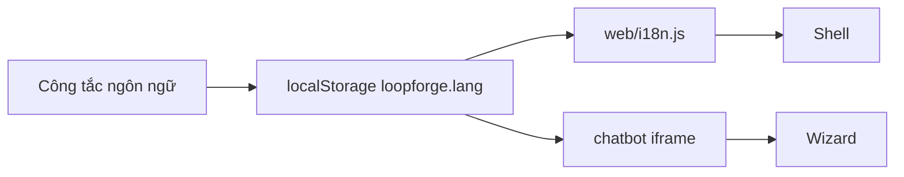

# UI tiếng Anh và tiếng Việt

Ngày: 2026-11-21

## Ràng buộc

Chỉ đổi chữ người dùng thấy trên UI. Không sửa logic.

Được sửa: chuỗi hiển thị, từ điển `zh → en` và `zh → vi`, công tắc ngôn ngữ, việc iframe chatbot tải lớp dịch UI hiện có, và test chỉ kiểm tra chữ còn sót trên bề mặt đã render.

Cấm sửa: handler, repo, SQL, migration, prompt SOP/vai trò, tool schema, điều kiện nhánh, validation, auth, routing, và mọi hành vi không phải hiển thị. Lỗi API giữ nguyên tiếng Trung trong Go. Nếu UI chèn nguyên văn chuỗi đó vào DOM thì chỉ thêm khóa từ điển, không sửa nguồn.

## Vấn đề

Shell đã sang tiếng Anh, wizard trong ảnh thì chưa. Wizard nằm trong iframe `/chatbot/`. Iframe không tải `web/i18n.js`, nên từ điển không chạy ở đó. `快速接入` đã có khóa tiếng Anh nhưng iframe không dùng.

Tiếng Trung là ngôn ngữ gốc của UI. Tiếng Anh là lớp phủ lúc chạy: `web/i18n.js` duyệt text node và một số attribute, thay bằng `web/i18n-en.js` (4606 khóa). `lfT(zh, en)` chỉ là lối tắt cho chuỗi ghép động. `lfSetLang` hiện coi mọi giá trị khác `en` là `zh`. Khóa lưu ở `localStorage['loopforge.lang']`.

## Phạm vi

| Bề mặt | Việc | Không làm |
|---|---|---|
| `web/` trừ Monaco, VS Code, ECharts | Lấp chữ UI còn tiếng Trung khi đang ở EN hoặc VI | Không đổi hành vi control |
| `/chatbot/` | Cùng lớp phủ, cùng khóa ngôn ngữ | Không đổi luồng chat, tool, hay render nội dung người dùng |
| Tên SOP/vai trò hiện trong danh sách | Khóa từ điển cho đúng chuỗi đang hiện | Không sửa SQL hay thân prompt |
| Lỗi API hiện thành chữ trên UI | Khóa từ điển cho đúng chuỗi đang hiện | Không sửa chuỗi trong Go |
| Monaco, VS Code, ECharts | Giữ locale riêng | Không nhét vào từ điển LoopForge |
| Comment, test fixture, log, nội dung người dùng gõ | Bỏ qua | Không dịch |

Số đo ngày 2026-11-21 là trần kiểm kê, không phải số việc còn lại. Một câu đã đủ mảnh trong từ điển thì không tính là sót.

| Bề mặt | Trần |
|---|---|
| Shell `web/` | 2407 literal tiếng Trung không khớp khóa, 72 file |
| Chatbot | 751/974 literal không có trong từ điển tiếng Anh, 53 file |
| API | 696 chuỗi lỗi trên 132 file Go. Chỉ những chuỗi UI hiện mới vào từ điển |
| Seed SQL | 11 file có tiếng Trung. Không sửa file |

## Cách làm

Không thêm thư viện i18n. Không tách chuỗi gốc thành catalog mới. Thêm `vi` vào cơ chế phủ hiện có và bắt iframe đọc cùng khóa.

`lfSetLang` phải nhận `zh | en | vi`. Hiện mọi giá trị khác `en` bị ép về `zh`.

## Thứ tự

1. Cho `/chatbot/` tải `i18n-en.js` và `i18n.js`, đọc `loopforge.lang`. Reload shell phải kéo theo iframe. Xong bước này, wizard phải hiện `Quick setup`, không còn `快速接入`. Chưa thêm tiếng Việt.
2. Một lệnh rà soát liệt kê chữ Hán còn sót trên UI đã render: shell và chatbot, ở EN. Phân loại thành chrome, chữ UI lấy từ API/catalog, và phần cố ý bỏ qua. Không sửa nguồn ngoài UI để làm sạch danh sách.
3. Lấp tiếng Anh theo bề mặt, wizard trước. Mỗi bề mặt có test kiểu `leftoverChinese` trên DOM đã render. Chuỗi ghép như `已连接 GitHub · ${login}` đi vào bảng pattern có sẵn của `i18n.js`, không dịch mảnh tự do.
4. Thêm `i18n-vi.js` và nút VI. Cùng thanh kiểm tra của bước 3. Tiếng Việt dịch từ chuỗi tiếng Trung gốc, không dịch từ bản tiếng Anh.

## Xong khi

- EN và VI không còn chữ Hán trên chrome của shell và chatbot, kể cả wizard trong ảnh.
- Công tắc nhớ lựa chọn sau reload và áp vào iframe.
- Test sót chữ đi đỏ khi một bề mặt UI còn tiếng Trung.
- Diff không đụng file ngoài UI và lớp dịch UI.
